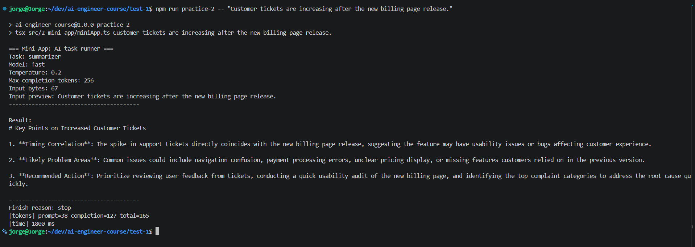
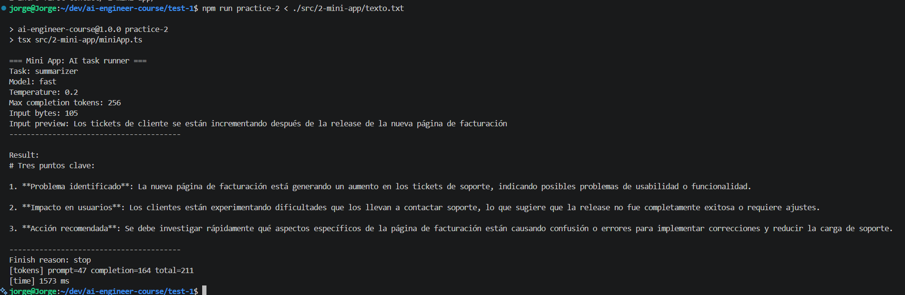
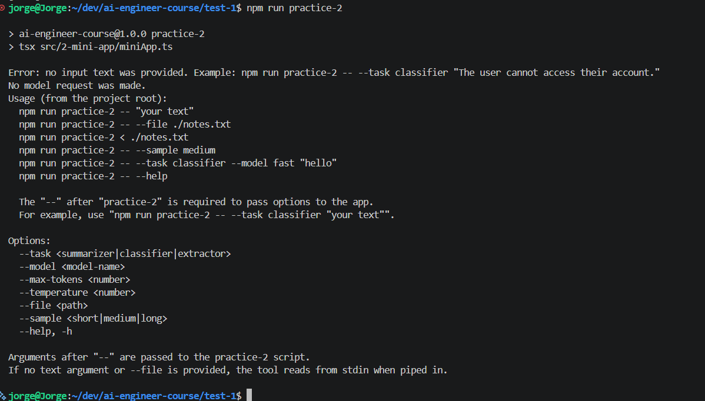
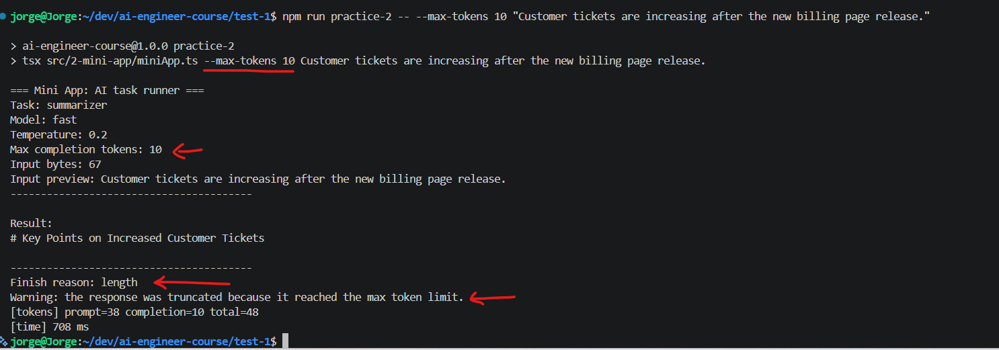

# Mini App for model testing

This mini app sends text to an OpenAI-compatible model and executes a single task:

- `summarizer`: returns exactly three key points
- `classifier`: classifies a message into a support category
- `extractor`: extracts relevant data such as a name, date, or amount

## Quick start

1. Copy `.env.example` to `.env` and set the API key.
2. Run one of the commands below.

## Examples

Run these commands from the project root. The `--` separates npm arguments
from arguments passed to the `practice-2` script.

```bash
npm run practice-2 -- "Customer tickets are increasing after the new billing page release."

npm run practice-2 -- --file ./src/2-test-models/examples/medium.txt

npm run practice-2 -- --sample short --task summarizer

npm run practice-2 -- --task classifier --model fast "The user cannot access their account after a password reset."

npm run practice-2 < ./src/2-test-models/examples/medium.txt
```

## Environment variables

`OPENAI_API_KEY` and `OPENAI_BASE_URL` are loaded from `.env` automatically via `dotenv`.

Example:

```bash
OPENAI_API_KEY=your_key_here
OPENAI_BASE_URL=https://ai.commitacademy.io/v1
MODELO=fast
MAX_TOKENS=256
```

## Notes

- The system prompt is kept separate from the user text.
- The app prints the finish reason and token consumption.
- If the model is cut by the token limit, it prints a warning.
- Optional parameters like `--task`, `--model`, `--max-tokens`, and `--temperature` are supported.


## Execution screenshots

1. Text passed as an argument:

   

2. Text read from a file:

   

3. Usage help shown when no text is provided:

   

4. Response truncated at the token limit:

   

## Analysis and test results

For the execution table and the analysis of token usage, variability, and model trade-offs, see [analisis.md](./analisis.md).
